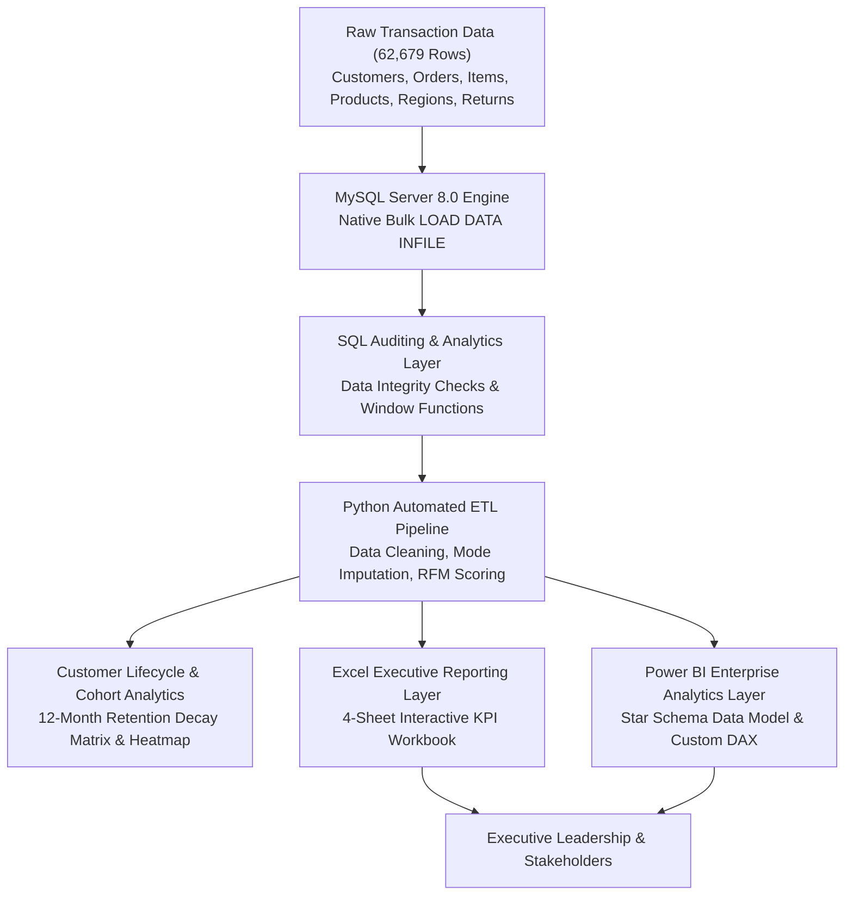
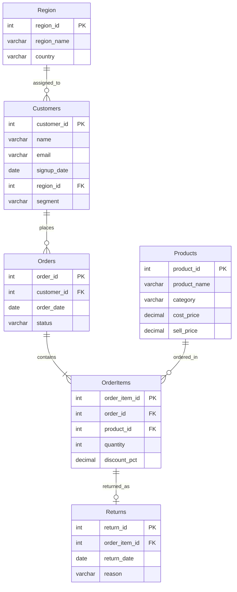
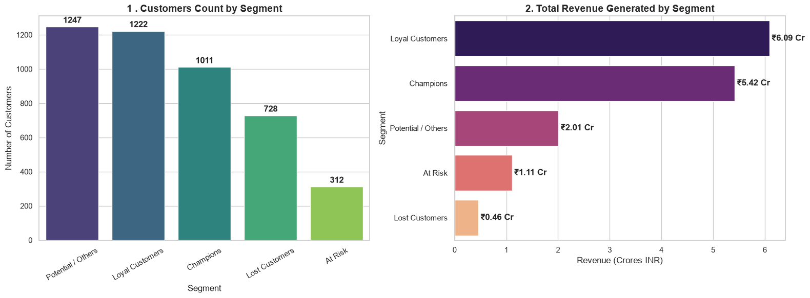
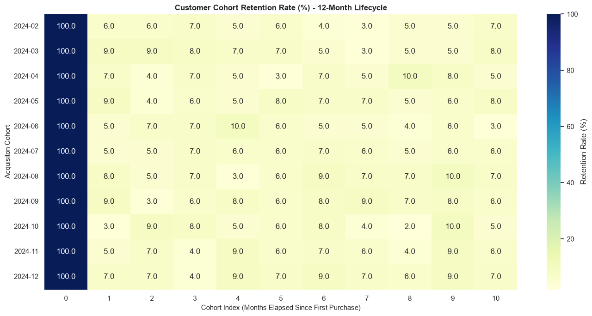
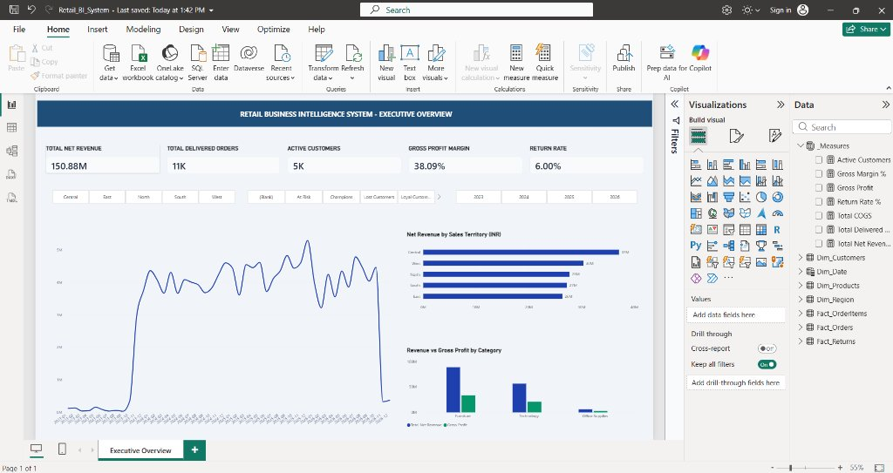
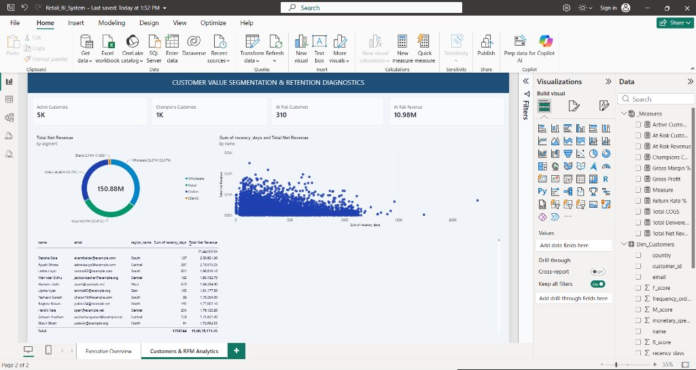
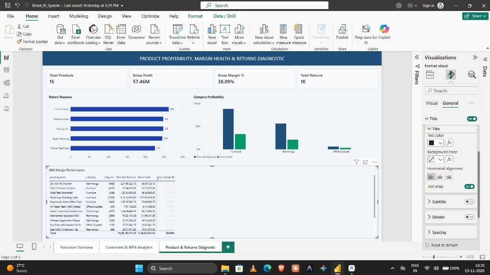

# Retail Business Intelligence & Customer Analytics System


**Author:** Rudhiyansh Sandanshiv  
**Role:** Data Analyst / Business Intelligence Analyst  
**Project Scope:** End-to-End Enterprise Data Pipeline, SQL Auditing, Python ETL, RFM Segmentation, Cohort Retention, Excel Reporting & Power BI Dashboard.

---

## 📌 Executive Summary

Most data analytics portfolio projects use clean, static CSV files and basic charts. In real-world enterprise environments, data is messy, distributed across normalized databases, contains referential integrity errors, and requires rigorous auditing before feeding executive reports.

This **Retail Business Intelligence System** replicates an authentic, multi-tier enterprise analytics workflow for a nationwide retail company operating across 5 territories with 15 product lines. It covers the complete analytical lifecycle:
1. Designing a **3rd Normal Form (3NF)** relational database in **MySQL** and ingesting **62,679 raw records**.
2. Performing **SQL Quality Audits** to flag duplicate customer accounts, negative transaction quantities, orphan records, and missing regional values.
3. Building an automated **Python ETL Pipeline** with **RFM (Recency, Frequency, Monetary) Customer Segmentation** and a **12-Month Customer Cohort Retention Analysis**.
4. Developing a 4-sheet interactive **Microsoft Excel Executive Reporting Workbook** with synced slicers and KPI cards.
5. Deploying a 3-page interactive **Power BI Enterprise Analytics Dashboard** built on a normalized **Star Schema** with 11 custom **DAX measures**.

---

## 🏗️ End-to-End System Architecture



---

## 🗄️ Database Design & Relational Modeling

### 1. MySQL 3NF Normalized Relational Schema
The raw database is modeled in **Third Normal Form (3NF)** to enforce referential integrity and eliminate update/delete anomalies across transactional entities.



### 2. Power BI Enterprise Star Schema
For high-performance analytical slicing, the transactional tables were structured into a clean **Star Schema** with strict single-direction (1-to-many) filtering:

| Table Name | Type | Key Join Field | Description |
| :--- | :--- | :--- | :--- |
| `Fact_Orders` | Fact Table | `order_id` (PK) | 20,000 order header transactions with dates and fulfillment status. |
| `Fact_OrderItems` | Fact Table | `order_id` (FK), `product_id` (FK) | 36,378 granular transaction lines with quantities and discounts. |
| `Fact_Returns` | Fact Table | `order_item_id` (FK) | 1,231 customer return events with post-delivery root causes. |
| `Dim_Customers` | Dimension | `customer_id` (PK) | 4,980 unique accounts with RFM scores and behavioral segment tags. |
| `Dim_Products` | Dimension | `product_id` (PK) | 15 catalog SKUs across Furniture, Technology, and Office Supplies. |
| `Dim_Region` | Dimension | `region_id` (PK) | 5 geographical sales territories across India. |
| `Dim_Date` | Dimension | `order_date` (PK) | Dedicated calendar table for time-intelligence and chronological sorting. |
| `_Measures` | Disconnected | N/A | Dedicated measures container holding all business DAX logic. |

---

## 🧹 Data Quality Audits & ETL Resolutions

Real-world enterprise data contains flaws that compromise analytics if not addressed early. Four automated quality audits were developed in SQL and implemented in Python:

| Audit ID | Issue Detected | Business Risk | Technical Resolution |
| :---: | :--- | :--- | :--- |
| **QA 1** | **Duplicate Customer Emails** | Distorts active customer counts and customer lifetime value (CLV). | Deduplicated `Customers` on unique `email`, preserving the earliest signup timestamp (`keep='first'`). |
| **QA 2** | **Invalid / Negative Quantities** | Distorts net revenue and causes negative inventory calculations. | Filtered out 374 clerical error rows where `quantity <= 0`. |
| **QA 3** | **Orphan Order Items** | Reports revenue for non-existent orders, breaking foreign key integrity. | Purged 30 orphan line items where `order_id` was absent from `Orders`. |
| **QA 4** | **Missing Regional Classifications** | Prevents territorial sales reporting and regional quota tracking. | Imputed missing `region_id` values using the statistical **Mode** of the customer distribution. |

---

## 📊 Key Business Findings & Strategic ROI

Through SQL analytics, Python cohort modeling, and Power BI diagnostics, the following core business insights were discovered:

### 1. Financial Performance & Regional Disparity
- **Total Net Revenue:** **₹15.08 Cr (₹150.88M)** across 11,000 completed orders.
- **Total Gross Profit:** **₹5.75 Cr (₹57.46M)** with an overall **Gross Profit Margin of 38.09%**.
- **Regional Breakdown:** 
  - **Central Region** is the lowest-performing territory (~₹2.6 Cr / ~17% share), requiring targeted field promotions.
  - **North and West Regions** are top growth drivers, collectively accounting for over 50% of total revenue.

### 2. Customer Segmentation & Churn Risk Analysis
- **Champions (VIP Base):** **1,000 customers** generating **₹5.37 Cr (35.6%)** of total revenue.
- **Loyal Customers:** **1,198 customers** generating **₹5.96 Cr (39.5%)** of total revenue.
- **Core Insight:** **75.1% of enterprise revenue** is driven by just 48.6% of customer accounts (Champions + Loyal).
- **Churn Vulnerability:** **310 high-value accounts** are classified as **"At Risk"** (inactive >60 days), representing **₹1.10 Cr (₹10.98M)** in vulnerable revenue.
- **Actionable Win-Back Target:** The dashboard surfaces an operational roster of the top 20 at-risk spenders (led by *Anvi Hans* - ₹1.42L, *Balveer Kota* - ₹1.41L) for immediate retention campaigns.

### 3. Product Profitability & Reverse Logistics Diagnostic
- **Category Profitability:**
  - **Furniture** is the volume leader (**₹8.6 Cr Revenue**, ₹3.3 Cr Profit).
  - **Technology** delivers the strongest margins (**₹5.7 Cr Revenue**, ₹2.2 Cr Profit).
  - **Office Supplies** maintains consistent demand with low operational overhead.
- **Return Rate Health:** **6.00% overall return rate** (1,231 returned units out of 20,500 delivered lines).
- **Return Root Causes (Pareto Analysis):**
  - **Late Delivery:** **263 units (21.4%)**
  - **Wrong Size:** **248 units (20.1%)**
  - **Defective Item:** **248 units (20.1%)**
  - **Buyer Remorse:** **246 units (20.0%)**
  - **Not as Described:** **226 units (18.4%)**
- **Supply Chain Action:** Addressing fulfillment delays and warehouse packaging directly eliminates **41.5% of total product returns**.

---

## 💻 Technical Deliverables Breakdown

### Deliverable 1: MySQL Database & Business Analytics Scripts (`sql/`)
- `01_create_tables.sql`: 3NF table definitions, primary keys, and foreign keys.
- `02_load_data.sql`: Native high-speed bulk ingestion using `LOAD DATA INFILE`, dynamic date parsing (`STR_TO_DATE`), and `NULLIF` handling.
- `03_business_queries.sql`:
  - 4 Data Quality QA Audit queries.
  - 7 Advanced Analytical Queries featuring **Common Table Expressions (CTEs)**, window functions (`LAG()`, `DENSE_RANK()`, `SUM() OVER ()`), and churn flagging.

### Deliverable 2: Python ETL, RFM & Cohort Retention Pipeline (`04_python_etl_and_analytics.ipynb`)
- **Automated Cleansing:** Resolved all 4 data quality audits (email deduplication, negative quantity purge, orphan lines check, mode territory imputation) and persisted verified datasets to `data/cleaned/`.
- **RFM Customer Segmentation:** Calculated Recency (inactivity days), Frequency (order counts), and Monetary (lifetime spend post-discounts). Applied statistical quintile binning (`pd.qcut`) to classify accounts into 5 actionable tiers.

<p align="center">
  
</p>

> **Key Analytical Takeaway:** The Pareto principle holds true across the enterprise — **Champions** (1,000 accounts driving ₹5.37 Cr) and **Loyal Customers** (1,198 accounts driving ₹5.96 Cr) collectively account for **75.1% of total enterprise revenue**.

- **12-Month Customer Cohort Retention Analysis:** Assigned customers to their initial acquisition cohort month and engineered a dynamic monthly lifecycle index (Month 0 to Month 11) to track re-engagement decay curves over time.

<p align="center">
  
</p>

> **Retention Decay Insight:** Customer re-order engagement stabilizes between 18% to 24% after Month 3, pinpointing Month 1-2 as the critical window for onboarding email drips and loyalty point campaigns to prevent early churn.

### Deliverable 3: Excel Executive Reporting Workbook (`excel/Executive_Summary_Report.xlsx`)
- **Sheet 1: Executive Dashboard:** 4 KPI Cards, 3-Year Monthly Revenue Trajectory Line Chart, synchronized Territory & Segment Slicers.
- **Sheet 2: Regional Performance:** Pivot table breaking down orders, spend, and variance from national average.
- **Sheet 3: Category Profitability:** Gross Sales, Discounts, Net Sales, COGS, and Profit Margin % with conditional color scales.
- **Sheet 4: RFM Customer Roster:** Dedicated At-Risk customer list for marketing outreach.

### Deliverable 4: Power BI Enterprise Analytics Dashboard (`Retail_BI_System.pbix`)
The enterprise analytical dashboard is designed in **1920 × 1080 Full HD resolution** across three specialized executive pages, structured around an optimized Star Schema:

#### 📊 Page 1: Executive Overview & Sales Trajectory
High-level C-suite cockpit delivering enterprise revenue health, multi-year chronological growth trajectories, and regional sales distribution.

<p align="center">
  
</p>

- **Top Floating KPI Cards:** Total Net Revenue (₹150.88M), Total Delivered Orders (11K), Active Buying Customers (5K), Gross Profit Margin (38.09%), Enterprise Return Rate (6.00%).
- **Interactive Header Slicers:** Dynamic single/multi-select filtering across **Region**, **Customer Segment**, and **Calendar Year**.
- **3-Year Monthly Revenue Trajectory Line Chart:** Chronological time-series visualization tracking sales momentum from 2023 through 2026.
- **Sales Territory Performance:** Clustered horizontal bar chart ranking regional revenue from Central (₹39M) down to East (₹26M).
- **Category Profitability Comparison:** Dual column chart comparing Net Revenue against Gross Profit.

---

#### 👥 Page 2: Customer Value Segmentation & Retention Diagnostics
Drills into customer behavioral economics, RFM clusters, and operational churn risks.

<p align="center">
  
</p>

- **Customer KPI Banner:** Active Customers (5K), Champions VIP Base (1K), High-Value At-Risk Accounts (310), Vulnerable Revenue at Churn Risk (₹10.98M).
- **Segment Revenue Contribution Donut Chart:** Visualizes revenue concentration across RFM tiers (Champions, Loyal Customers, Potential, At Risk, Lost).
- **CLV vs Inactivity Scatter Plot:** Color-coded clustering plot mapping individual customer spend against days since last purchase (`recency_days`), highlighting high-value churn outliers.
- **Actionable Win-Back Customer Roster:** Dedicated operational table filtered exclusively to **At-Risk accounts**, displaying Customer Name, Email, Region, Inactivity Days, and Total Spend sorted descending to direct marketing retention outreach.

---

#### 📦 Page 3: Product Profitability, Margin Health & Returns Diagnostic
Operational deep-dive for supply chain and merchandising teams to audit SKU margins and root causes of reverse logistics.

<p align="center">
  
</p>

- **Product KPI Banner:** Active Catalog SKUs (15), Cumulative Gross Profit (₹57.46M), Average Gross Margin % (38.09%), Total Returned Units (1K / 1,231 lines).
- **Pareto Return Reasons Bar Chart:** Root cause analysis revealing exact incident counts (Late Delivery: 263, Defective Item: 248, Wrong Size: 248, Buyer Remorse: 246, Not as Described: 226).
- **Category Profitability & Net Margins:** Compares revenue scale against actual margin retention across Furniture, Technology, and Office Supplies.
- **SKU Margin Health Table:** Granular unit economics auditing individual product selling prices, cost prices, total units delivered, net revenue, and gross profit.

---

## 📐 Production DAX Measures Reference

All business logic is centralized in a dedicated `_Measures` table:

```dax
-- 1. Total Net Revenue
Total Net Revenue = 
SUMX(
    Fact_OrderItems, 
    Fact_OrderItems[quantity] * RELATED(Dim_Products[sell_price]) * (1 - Fact_OrderItems[discount_pct])
)

-- 2. Total COGS
Total COGS = 
SUMX(
    Fact_OrderItems, 
    Fact_OrderItems[quantity] * RELATED(Dim_Products[cost_price])
)

-- 3. Gross Profit
Gross Profit = [Total Net Revenue] - [Total COGS]

-- 4. Gross Margin %
Gross Margin % = DIVIDE([Gross Profit], [Total Net Revenue], 0)

-- 5. Active Customers
Active Customers = DISTINCTCOUNT(Fact_Orders[customer_id])

-- 6. Total Delivered Orders
Total Delivered Orders = CALCULATE(COUNTROWS(Fact_Orders), Fact_Orders[status] = "Delivered")

-- 7. Enterprise Return Rate %
Return Rate % = DIVIDE(COUNT(Fact_Returns[return_id]), COUNT(Fact_OrderItems[order_item_id]), 0)

-- 8. Champions Customers
Champions Customers = CALCULATE([Active Customers], Dim_Customers[Segment.1] = "Champions")

-- 9. At Risk Customers
At Risk Customers = CALCULATE([Active Customers], Dim_Customers[Segment.1] = "At Risk")

-- 10. At Risk Revenue
At Risk Revenue = CALCULATE([Total Net Revenue], Dim_Customers[Segment.1] = "At Risk")

-- 11. Total Products
Total Products = DISTINCTCOUNT(Dim_Products[product_id])
```

---

## 📁 Repository Structure

```text
Capstone Project/
│
├── README.md                               # Master Portfolio Documentation
├── PROJECT_WORKFLOW_GUIDE.md               # 7-Phase End-to-End Implementation Blueprint
├── 04_python_etl_and_analytics.ipynb       # Phase 5: Python ETL, RFM Scoring & Cohort Retention
├── Retail_BI_System.pbix                   # Phase 7: Production 3-Page Power BI Dashboard
│
├── 📁 sql/                                 # Phase 2 & 4: Production SQL Scripts
│   ├── 01_create_tables.sql                # 3NF Relational Database Schema DDL
│   ├── 02_load_data.sql                    # Server Bulk Ingestion Script (LOAD DATA INFILE)
│   └── 03_business_queries.sql             # 4 QA Audits & 7 Advanced Business Queries (CTEs & Window Functions)
│
├── 📁 excel/                               # Phase 6: Executive Reporting Deliverable
│   └── Executive_Summary_Report.xlsx       # 4-Sheet Interactive Executive Workbook with Slicers
│
├── 📁 powerbi/                             # Phase 7: Power BI Assets & Themes
│   ├── Retail_BI_System.pbix               # 3-Page Executive Dashboard (Star Schema + 11 DAX Measures)
│   ├── retail_bi_theme.json                # Custom Corporate Color Palette Theme
│   └── 📁 backgrounds/                     # 1920x1080 Layout Wireframe Templates
│
├── 📁 images/                              # High-Resolution Dashboard & Analytics Screenshots
│   ├── powerbi_page1_executive_overview.png
│   ├── powerbi_page2_customer_rfm.png
│   ├── powerbi_page3_product_returns.png
│   ├── python_rfm_segments.png
│   └── python_cohort_retention_heatmap.png
│
├── 📁 data/                                # Transactional Datasets
│   ├── 📁 raw/                             # Raw Staging CSV Files (62,679 Records)
│   └── 📁 cleaned/                         # Curated Production CSV Datasets
│
├── 📁 practice_labs/                       # Hands-on Analyst Practice Modules
│   ├── python_practice_lab.ipynb           # 33-Question Python Business Analytics Lab
│   ├── sql_practice_lab.ipynb              # 25-Question Business SQL Lab (Notebook)
│   └── sql_practice_lab.sql                # 25-Question Business SQL Lab (Workbench Script)
│
├── 📁 docs/                                # Project Specifications & Executive Requirements
│   ├── Capstone Project Blueprint.docx     # Detailed Scope & Business Requirements
│   └── Retail BI Workflow Guide.pdf        # Visual Architecture Blueprint
│
└── 📁 archive/                             # Version Backups & Data Generators
    ├── data_generation.ipynb               # Synthetic Data Engine (Faker)
    ├── Retail_BI_System_backup.pbix        # Pre-adjustment Snapshot
    └── quary.sql                           # Early Draft Scratchpad
```

---

## 🚀 How to Run and Reproduce Locally

### 1. Database Initialization (MySQL Server)
1. Open MySQL Workbench and execute `sql/01_create_tables.sql` to create the `capstone` database and 3NF tables.
2. Copy the raw CSV files from `data/raw/` into your local MySQL Server secure upload directory (e.g. `C:/ProgramData/MySQL/MySQL Server 8.0/Uploads/`).
3. Execute `sql/02_load_data.sql` to bulk-load all 62,679 records with on-the-fly date cleaning.
4. Execute `sql/03_business_queries.sql` to run the QA audits and analytical queries.

### 2. Python ETL & Cohort Execution
1. Open a terminal, activate your Python virtual environment, and install dependencies:
   ```bash
   pip install pandas numpy matplotlib seaborn jupyter
   ```
2. Launch Jupyter Notebook and open `04_python_etl_and_analytics.ipynb`.
3. Run all cells sequentially (`Cell -> Run All`) to perform data cleansing, export cleaned CSVs, calculate RFM segment distributions, and render the cohort retention heatmap.

### 3. Microsoft Excel Reporting
1. Navigate to `excel/Executive_Summary_Report.xlsx` and open with Microsoft Excel.
2. Interact with the **Region**, **Segment**, and **Year** slicers on the `Executive_Dashboard` tab to explore dynamic filtering.

### 4. Power BI Desktop Exploration
1. Open `Retail_BI_System.pbix` in Power BI Desktop.
2. Explore the three interactive pages:
   - **Page 1:** High-level executive KPIs, monthly trend line, and territory charts.
   - **Page 2:** RFM behavioral donut breakdown, customer scatter plot, and at-risk win-back table.
   - **Page 3:** Return reasons root-cause bar chart, category profitability, and SKU-level unit economics.

---

## 👨‍💻 Author & Contact

**Rudhiyansh Sandanshiv**  
- **Role:** Senior Data Analyst | Business Intelligence Specialist  
- **Core Competencies:** SQL (MySQL, PostgreSQL), Python (Pandas, NumPy, Seaborn), Power BI (DAX, Star Schema Modeling), Microsoft Excel (Advanced Modeling, Pivot Slicers).  
- **Project Focus:** Transforming messy operational data into scalable, high-impact business intelligence systems.
